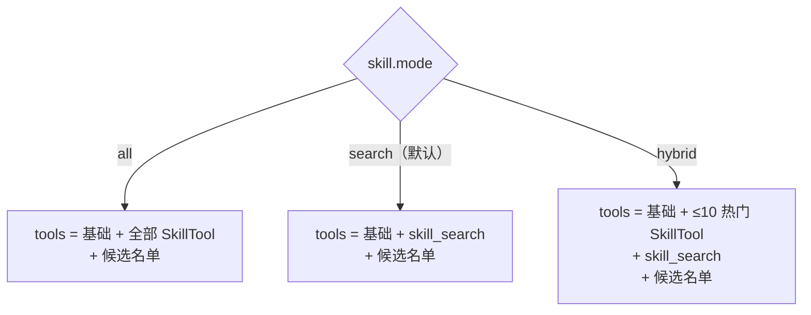
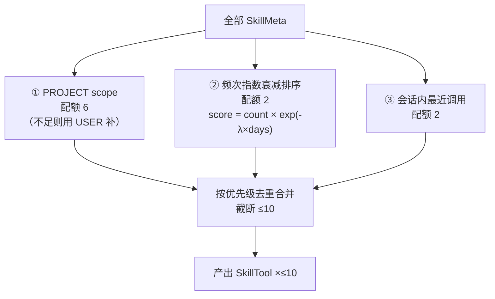

## Context

`refactor-skill-index-layer` 已交付 `SkillPool`（元数据常驻 + 正文按需 + 倒排索引），但 tools 段仍是 **1 skill = 1 Tool 全量注册**：

```java
// AgentLoop.toRequest()
for (var t : tools.list()) {
    specs.add(new ToolSpec(t.name(), t.description(), t.inputSchema()));
}
```

`SkillTool.description()` = 固定前缀 + frontmatter description，inputSchema 是空对象 → 每条约 90 token。

| skill 数 | tools token | 占 83808 阈值 |
|---------|------------|--------------|
| 20 | ~1.8k | 2% |
| 1000 | ~90k | **107%** ❌ |
| 10000 | ~900k | **1073%** ❌ |

除 token 预算外还有三个连带问题：

1. **KV cache 崩塌** — tools 段在请求体里，任何一个 skill 描述变化都会击穿 prefix cache
2. **模型选择退化** — 业界经验：工具数超过 ~50-100，function calling 选错率显著上升
3. **HTTP body 体积** — 900k token ≈ 3.5 MB JSON，每次工具迭代重传

Memory 侧已有成熟的三层召回（`MemoryRetriever`：字面 → embedding → sideQuery），Skill 侧完全没复用。

约束：

- 本 change **行为变更**（写 delta spec，MODIFIED 现有 `skills` 两条 Requirement + ADDED 三条）
- 依赖 `refactor-skill-index-layer` 已合入 main
- 默认档必须是**最安全**的（0 直露），而不是保持现状的全暴露

## Goals / Non-Goals

**Goals:**

- tools 段规模与 skill 总数**解耦**：恒定 ≤ 基础工具 + 10 直露 + 1 `skill_search`
- 三档模式可配置：`all`（现状）/ `search`（0 直露，默认）/ `hybrid`（≤10 直露 + 检索）
- 检索链路复用 Memory 三层结构：倒排预筛 → embedding KNN → top-k
- embedding 不可用时退化为纯倒排，不抛异常
- 频次统计持久化 + 指数衰减，避免老技能永久霸榜
- 轮内缓存候选名单（工具迭代会多次调 `toRequest()`）

**Non-Goals:**

- 不做分层下钻（Claude Code 的 category → subcategory → skill 三层），留后续
- 不引入 tag 体系（人工分类），纯靠 description + embedding
- 不做跨进程的候选名单缓存（每轮重算，倒排+KNN 已在毫秒级）
- 不改前端 UI（tool 形状对模型透明，用户无感）
- 不改 `MEMORY.md` / 长期记忆的任何行为

## Decisions

### D1: 三档模式，`search` 为默认

```java
public enum SkillMode {
    ALL,        // 全暴露（现状）
    SEARCH,     // 0 直露，纯检索 ← 默认
    HYBRID      // ≤10 直露 + 检索
}
```



**为什么默认 `search` 而不是 `all`**：保持现状意味着「10000 skill 时工具段爆掉」这个 bug 继续存在；默认 `search` 则从第一天就是安全的。`< 10 个 skill` 的用户实际无感（候选名单就是全部，都通过 `skill_search` 触达，只是多一次工具调用）。

**为什么保留 `all`**：小规模场景下模型直接看到所有工具更准（不依赖它「记得」去调 search）。且它是回滚的兜底档。

### D2: 候选名单进 system prompt（不是 tools[]）

```java
// AgentLoop.resolveSystemPrompt()
String base = /* 身份 + 行为 + 存储 + 指引 */;
if (skillCandidates.isEmpty()) return base;
return base + "\n\n# Available Skills / 可用技能\n\n"
     + candidates.stream().map(m -> "- " + m.name() + ": " + truncate(m.description(), 40))
                   .collect(joining("\n"))
     + "\n\n调用同名工具或 skill_search 获取完整指令。\n";
```

**为什么不放进 tools[]**：候选是每轮变化的，放 tools 会击穿 KV cache；放 system 末尾则 messages 数组前缀稳定。

**为什么截断 40 字**：k=20 × 40 字 ≈ 600 token。完整 description（~80 字）会到 1.2k，省下的 600 token 不值得牺牲模型判断力。

### D3: `skill_search` 工具（模型主动精化）

```java
public class SkillSearchTool implements Tool<String, String> {
    @Override public String name() { return "skill_search"; }

    @Override public String description() {
        return "按关键词检索可用技能，返回匹配的技能名与描述。"
             + "找到后用同名工具加载完整指令。可多次调用以精化检索。";
    }

    @Override public Map<String, Object> inputSchema() {
        return Map.of("type", "object",
            "properties", Map.of("query", Map.of("type", "string", "description", "检索关键词")),
            "required", List.of("query"));
    }

    @Override public Mono<ToolResult<String>> execute(String query, ToolContext ctx) {
        return Mono.fromSupplier(() ->
            pool.search(query, config.recallK()).stream()
                .map(m -> m.name() + ": " + m.description())
                .collect(joining("\n")));
    }
}
```

**这是 `SEARCH` 与 `HYBRID` 档唯一的 tools 增量**（`ALL` 档不注册它，因为全暴露了不需要搜）。

### D4: 热门选择器（三配额叠加）



**为什么 PROJECT 优先**：项目级 skill 是「当前项目专用」，用户装它就是因为现在要用；跨项目的 USER skill 让位。

**为什么 PROJECT 也要卡配额**：monorepo / 巨型项目可能有 500 个 `.agent-demo/skills/`，不卡会独霸 10 个位置。配额 6 留 4 个给频次与最近用。

**为什么用「最近用过的」而不是「首次曝光过的」**：后者会把用户从没主动调过的 skill 也塞进 tools，白占位置。

### D5: 频次持久化 + 指数衰减

```java
// ~/.agent-demo/skill-usage.json
{
  "pdf-form-filler": { "count": 12, "lastUsedMs": 1758000000000 },
  "k8s-deploy":      { "count": 3,  "lastUsedMs": 1757000000000 }
}
```

```java
double score(String name) {
    Usage u = usage.get(name);
    if (u == null) return 0.0;
    double days = (nowMillis() - u.lastUsedMs()) / 86_400_000.0;
    return u.count() * Math.exp(-lambda * days);   // λ 默认 0.05
}
```

λ=0.05 → 半衰期 `ln(2)/0.05 ≈ 13.9 天`。三个月前用 10 次的技能：score = 10 × exp(-0.05×90) ≈ 0.11，几乎沉底。

**写入时机**：`SkillTool.execute()` 成功时 + `skill_search` 命中时（记「被搜到」也算轻度使用）。原子写（tmp + ATOMIC_MOVE），与 `SettingsService.writeAtomic` 同构。

**为什么不用 settings.yaml**：`SettingsService.patch` 每次写都广播 `settings.changed` SSE；频次是高频写（每次工具调用），会打爆 SSE。

### D6: 检索链路 = 倒排预筛 + embedding KNN

```java
public List<SkillMeta> search(String query, int k) {
    // ① 倒排预筛：query 分词 → 命中 skillNames 并集
    Set<String> candidates = inverted.lookupAll(tokenize(query));   // 10000 → ~200

    // ② embedding KNN（仅在 candidates 非空且 embedder ready 时）
    if (embedder.isReady() && !candidates.isEmpty()) {
        float[] qv = embedder.embed(query);
        return vectorIndex.knn(qv, candidates, k);                  // 200 → k
    }

    // ③ 降级：纯倒排，按 name 字典序截断
    return candidates.stream().sorted().limit(k).map(this::require).toList();
}
```

**为什么倒排先行**：10000 条全跑 KNN 是 `10000 × 512` 次浮点运算；预筛到 200 后是 `200 × 512`，**快 50 倍**。

**为什么预筛为空时不回退到全量 KNN**：query 完全不含已知关键词（如「帮我看看这个」）时全量 KNN 只会返回一批「cosine 都差不多」的无关结果，噪声大于收益。此时返回空候选，让模型走基础工具或换 query。

### D7: 轮内缓存候选名单

```java
private volatile String cachedQuery;
private volatile List<SkillMeta> cachedCandidates;

private List<SkillMeta> skillCandidatesFor(String query) {
    if (query.equals(cachedQuery)) return cachedCandidates;
    cachedCandidates = pool.search(query, config.recallK());
    cachedQuery = query;
    return cachedCandidates;
}
```

与 `AgentLoop.memorySectionFor`（`fix-memory-recall-wiring` 引入）完全同构——同一轮内工具迭代会多次调 `toRequest()`，query 不变。

### D8: `SkillsPlugin.tools()` 按 mode 分支

```java
public List<Tool<?, ?>> tools() {
    return switch (mode) {
        case ALL    -> pool.all().stream().map(s -> new SkillTool(s, pool)).toList();
        case SEARCH -> List.of(new SkillSearchTool(pool, config));
        case HYBRID -> {
            var hot = hotSelector.pick(config.hybridDirectLimit());
            yield concat(hot.stream().map(s -> new SkillTool(s, pool)).toList(),
                         List.of(new SkillSearchTool(pool, config)));
        }
    };
}
```

**注意**：`SkillsPlugin.tools()` 在 `PluginManager.init()` 时调一次（启动期），不是每轮。所以**候选名单不能走这里**——必须由 `AgentLoop.toRequest()` 每轮渲染（见 D2）。`tools()` 只负责「哪些 skill 变成真工具」这个**启动期决策**。

**这带来一个后果**：`HYBRID` 的热门集合在**整个进程生命周期内固定**，不随「会话内最近用」变化。要让热门动态更新，有两个选项：
- (a) 热门只由「PROJECT scope + 频次」决定（启动期固定），「会话内最近用」不参与热门而是**动态追加**到 tools（每轮重算）
- (b) 每次 `toRequest()` 重新组装 tools（放弃 `tools.list()` 缓存）

倾向 (a)：`tools()` 返回启动期算好的基础集（PROJECT 6 + 频次 2），每轮额外把「会话内最近用的 ≤2」动态加进去。实现上 `toRequest()` 遍历 `tools.list()` 后追加动态项。

## Risks / Trade-offs

| 风险 | 缓解 |
|------|------|
| **默认档切换导致行为回归**：现有 <10 skill 用户从「直接看到工具」变成「先读候选名单再调 search」 | 候选名单里 skill 名与真工具名一致，模型仍可直接调；且候选名单就在 system prompt 里，不需要「记得」去搜。T2 任务专门加 `SkillModeWiringTest` 覆盖三档 tools 形状 |
| **`skill_search` 多一次工具往返** | 一次 RTT ≈ 工具执行本地检索（<10ms），可接受；换来的是模型能换关键词精化 |
| **频次文件写放大**：每次工具调用都写 json | 内存累积 + 延迟写（每 10 次或 turn 结束 flush 一次）；单文件几百 KB 量级 |
| **embedding 冷启动耗时**：10000 条 bge-small-zh 推理 | 放后台线程；未就绪时纯倒排可用（不阻塞）。若用户在意启动时间可把 `skill.mode` 设 `all` + 少量 skill |
| **PROJECT 配额 6 可能不够**：用户装了 10 个项目级 skill | 配额可配（`hybridProjectQuota`）；超出的仍可通过候选名单 + search 触达 |
| **模型忽略候选名单**：skill 很多时可能不读 system 末尾 | 候选名单放在 system prompt **末尾**（recency 效应最强位置）；`skill_search` 的 description 里显式说明「候选名单里的技能可用同名工具加载」 |

## Migration Plan

**无数据迁移**。`skill-usage.json` 不存在时视为空。

回滚策略：
- 行为层：把 `skill.mode` 设为 `all` 即回到重构前的暴露方式（无需回滚代码）
- 代码层：`git revert` 单提交

**灰度建议**：先上 `mode: search`（默认），观察 1-2 天；确认无异常后如需更好体验切 `hybrid`。

## Open Questions

（已全部在 explore 阶段定稿）

1. **λ 默认值 = 0.05**（半衰期 ~13.9 天），暴露为 `agent.skill.decay-lambda` 可配。选 0.05 而非 0.02：0.02 的 35 天半衰期会让三个月前的常用技能永久霸榜；0.05 让老技能自然下沉。
2. **config 路径 = `agent.skill.*`**：与 `agent.permission.*` / `agent.worktree.*` 对称。六个参数：
   ```yaml
   agent:
     skill:
       mode: search              # all | search | hybrid
       hybrid-direct-limit: 10    # hybrid 档直露总数上限
       hybrid-project-quota: 6    # 其中 PROJECT scope 占的名额
       recall-k: 20               # 候选名单长度
       decay-lambda: 0.05         # 频次指数衰减系数
       description-truncate-chars: 40   # 候选名单里描述截断长度
   ```
3. **`SkillsPlugin.fragment()` 改为静态说明**：Plugin 接口的 `fragment()` 是启动期常量，无法承载每轮变化的候选名单。改为输出静态的三 scope 目录位置 + 「技能以工具形式暴露，长尾用 `skill_search` 检索」的用法说明；候选名单由 `AgentLoop.toRequest()` 每轮渲染到 system prompt 末尾。此改动需同步 MODIFIED 现有 `skills` spec 的「Skill 工具注册与摘要注入」Requirement。
4. **`all` 档不设硬上限**：`all` 的语义就是「回到重构前的全暴露」，用户主动设置时应自行承担规模代价。文档（README / spec）在说明 `all` 时明确标注「skill 数量大时会导致 tools 段超预算，推荐 `search` 或 `hybrid`」。

## 附：定稿后的配置契约

| 参数 | 类型 | 默认 | 作用范围 |
|------|------|------|---------|
| `mode` | enum | `search` | 三档分支 |
| `hybrid-direct-limit` | int | 10 | 仅 hybrid：直露总数上限 |
| `hybrid-project-quota` | int | 6 | 仅 hybrid：PROJECT scope 名额（≤ direct-limit） |
| `recall-k` | int | 20 | 三档：候选名单长度 |
| `decay-lambda` | double | 0.05 | 仅 hybrid：频次衰减系数 |
| `description-truncate-chars` | int | 40 | 三档：候选名单描述截断 |

非法值处理：`mode` 非法值 → 回退 `search` + WARN；数值参数非法（≤0）→ 用默认值 + WARN。**不抛异常**（配置错误不该阻断启动）。